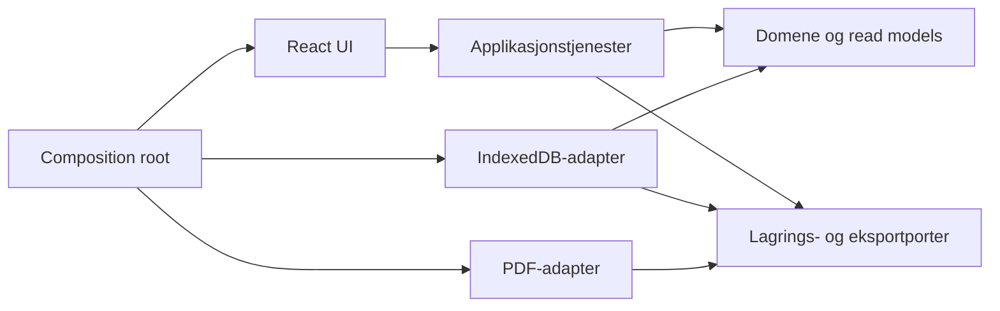
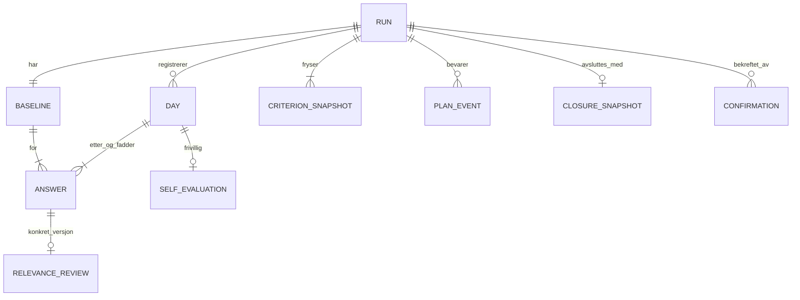

# Arkitektur – Digital kjørevurdering

**Godkjent arkitekturbaseline 2026-11-05.** Prosjekteier har godkjent alle anbefalte valg Q1–Q7. `[ADOPTED]` omfatter tidligere produktvedtak og de nå godkjente arkitekturvalgene; opprinnelse og begrunnelser bevares i [beslutningsloggen](.memlog.md). [Sluttrapporten](finalization-report.md) registrerer vedtakene. Godkjenningen gjelder V1-arkitekturen, ikke utførte apptester, produksjonsbruk eller formell ferdigstilling av PRD.

## Design Paradigm

Lett heksagonal klientarkitektur: ett domene, applikasjonstjenester og utskiftbare adaptere. Domene eier vurderingsregler; ett løpsaggregat eier konsistent tilstand. React eier visningen. Ingen backend eller delt datalager i V1. Piler angir tillatte kodeavhengigheter:



## Invariants & Rules

### AD-1 — Felles domene og avhengighetsretning [ADOPTED]

- **Binds:** Alle senere arbeidsområder.
- **Prevents:** Ulike regler for samme vurdering i UI, lagring og eksport.
- **Rule:** UI bruker applikasjonskommandoer/read models; ingen direkte databasekall. Domene importerer verken React, PDF-bibliotek eller nettleser-API. Adaptere implementerer porter. Samme domene validerer alle mutasjoner; PDF mottar en validert dokumentmodell og har ingen egen faglig beslutningslogikk.

### AD-2 — Statisk demo og avgrenset PWA [ADOPTED]

- **Binds:** Demo, bygg, utrulling, plattformgjenbruk.
- **Prevents:** Ulike lagringssteder, skjulte tjenester og utilsiktet offline-/produksjonsløfte.
- **Rule:** Start fra `create-vite` sin `react-ts`-mal i fremtidig `app/`, med vanlig CSS avledet fra godkjent DESIGN. Lever statiske filer på stabil HTTPS-origin; ingen serverlagring, innlogging, CDN, analyse eller integrasjon. Manifest/ikoner og installasjonsprøve inngår; ingen service worker i V1. Alle arbeidsflater og PDF-ressurser lastes før registrering åpnes. Kaldstart/oppfrisking uten nett garanteres ikke. Mobil krever HTTPS-host; PC-ens localhost er ikke telefonens localhost. Leverandør velges før publisering, ingen publisering er utført.

### AD-3 — Atomisk, lokal autoritet [ADOPTED]

- **Binds:** FR-9–15, NFR-3/4, alle skriv og bekreftelser.
- **Prevents:** Halvlagrede bekreftelser, tapte samtidige skriv og falsk lagringsstatus.
- **Rule:** IndexedDB er autoritativt for samme origin/profil/enhet. Ett aggregat per løp inneholder førvurdering, dager, planhistorikk, bekreftelser og avslutning. Én `readwrite`-transaksjon leser siste aggregat, kontrollerer rolle/låser/forventet revisjon, validerer og skriver aggregat og kommandoresultat samlet. Ingen nettverkskall eller annen venting som lar transaksjonen utløpe. Vis «Lagret på denne enheten»/låst først ved transaksjonens `complete`, aldri ved enkeltrequestens success. Abort gir ingen tilstandsendring. Be om streng durability der støttet; dette er ingen backupgaranti.

### AD-4 — Lagring og gjenopptakelse A4/A8 [ADOPTED]

- **Binds:** FR-9–11, NFR-3, alle redigerbare felter.
- **Prevents:** At nettstatus forveksles med lagringsstatus eller ulagrede endringer forsvinner ubemerket.
- **Rule:** Målet er transaksjonscomplete innen 2 s etter siste endring under normal test; autosave må startes tidlig nok til dette. Ved kontinuerlig skriving forsøk flush minst hver 2 s. «Lagret» gjelder bare siste kvitterte revisjon; nytt input blir straks dirty. Før rolle-/ruteskifte flushes utkast; ved feil beholdes innhold og skiftet avbrytes. Bekreftelser krever rent berørt innhold og egen atomisk transaksjon. En lastet app kan fortsatt registrere, lagre og bekrefte under nettbrudd når lokalt lager virker. Ingen serverkø eller «venter på synk». Ved feil vises «Endringene er ikke lagret. Prøv igjen.» og dirty innhold beholdes i minne uten løfte om overlevelse ved lukking.

| Betingelse | Godkjent mål og grense |
| --- | --- |
| Nettbrudd i lastet app | 60 s brudd; null tap av kvitterte data; videre lokal lagring og låsing prøves. |
| Gjenåpning/refresh med nett | Samme origin, profil, enhet og bevart lager: riktig løp og låser innen 5 s fra åpning; separat valg av løp skal ikke kreves på nytt. |
| Nett tilbake i åpen app | Brukbar innen 5 s etter at eventuelle manglende appressurser er tilgjengelige; ingen dataopplasting kreves. |
| Ingen nett ved kaldstart/refresh | Ikke akseptansekrav; vis tilgjengelig feil uten å hevde at data er slettet. |
| Kvote/lagring sperret | Oppstartsprøve før registrering; feil sperrer skriving/bekreftelse, aldri stilltiende minnelager. |
| Bevaring | Normal gjenåpning etter lukking prøves. Persistent storage forespørres der støttet; avslag vises uten falskt bevaringsløfte. Ingen automatisk tidsbasert sletting i V1. |
| Utenfor garantien | Privat profil, slettet/utkastet nettleserlager, byttet origin/enhet/profil, strømbrudd og OS-krasj. Ingen backup/gjenoppretting av slettet database loves. |

### AD-5 — Repetisjon og foreldet visning [ADOPTED]

- **Binds:** Alle kommandoer, nettbruddsforsøk, gamle faner og dialoger.
- **Prevents:** Dobbel dag, dobbel planutvidelse, overskriving av ny lås.
- **Rule:** Kommando har `commandId`, `runId`, aktiv `actor`, `expectedRevision` og payload. Samme ID/payload returnerer lagret resultat før revisjonssjekk; samme ID med annen payload avvises. Ny ID må passe siste revisjon. UI serialiserer per løp; databasekontrollen gjelder også andre faner. Ved revisjonsavvik lastes faktisk snapshot før nytt forsøk; ulagret tekst beholdes separat for brukerens kontroll, aldri automatisk merge. Gjentatt oppretting for samme dato returnerer eksisterende dag uten overskriving. Låser valideres på nytt ved hver mutasjon, også fra gammel skjerm.

### AD-6 — Separate, monotone låser [ADOPTED; teknisk avledning]

- **Binds:** FR-3/11–15, SM-8, alle felt.
- **Prevents:** At låst historikk endres via profil, rollebytte eller delvis lagring.
- **Rule:** Bekreftelser er eksplisitte kommandoer, aldri følge av lagring/utfyllingsgrad. Følgende payload og bekreftelse lagres atomisk; senere mutasjoner av feltene avvises. En senere lås opphever aldri en tidligere. Navn/rolle/dato er historiske snapshots; endret profil/faddertilknytning omskriver dem ikke. Hver rolle bekrefter bare egen del; navn er ikke identitetsverifisert e-signatur.

| Kommando/lås | Krever | Innhold som fryses |
| --- | --- | --- |
| `ConfirmBaseline` | Sjåfør; 22 gyldige før-svar, A10-begrunnelser, identitet/dato/tilhørighet og gjeldende faddernavn | Førvurdering og dag-1-identitet/dato/tilhørighet; dag-1-arv opprettes samtidig. Etterregistrering åpnes først etter kvittering. |
| `ConfirmDriverDay` | Sjåfør; låst førvurdering, dagens 22 gyldige svar, begrunnelser, identitet/dato og gjeldende faddernavn | Etter-svar og evalueringstilstand (ikke tilbudt, hoppet over eller innsendt); dag 2–5 også identitet/dato/tilhørighet. Manglende buss/linjer/tider blokkerer ikke dette steget. |
| `ConfirmMentorDay` | Fadder; sjåførens nødvendige låser, 22 egne svar, gyldig relevansbehandling, eget daglig oppfølgingsvalg og alle obligatoriske felt | Fadderdel, behandling, kommentarer, dagens planregistrering, buss/linjer/tider, faktisk bekreftende fadder; hele dagen låses. |
| `CloseRun` | Fadder; minst én dag og alle opprettede dager låst; eksplisitt Godkjent/Oppfølgingsbehov | Konklusjon, avslutningsutfall, avsluttende fadder og dokument-snapshot; hele løpet lukket. |

Buss/linjer redigeres av fadder; tider av begge til dagslås. Faddertilknytning kan endres til dagslås, selv etter sjåførlås. Konklusjon tilhører løpet og kan redigeres etter dagslås frem til avslutning. Ingen generell rettings-/gjenåpningskommando.

### AD-7 — Felles svarmodell og versjonert relevans [ADOPTED; teknisk avledning]

- **Binds:** FR-5–8, alle vurderinger, historikk og eksport.
- **Prevents:** Kopiert førvurdering hver dag, foreldet relevansgodkjenning og én sammenslått mening.
- **Rule:** Ett kriteriesett har 22 stabile ID-er og fast rekkefølge. Løpet fryser kriterietekst, regelversjon og godkjent hjelpetekstversjon ved opprettelse. Ingen historikk fortolkes ut fra siste globale konfigurasjon. `Answer` har stabil ID, fase, kriterie-ID, svar og `answerRevision`; ubesvart er null, ikke et valgbart svar. Dag 1 har etterposisjoner for før-Ikke relevant med låst kilde-ID, svar og opprinnelig begrunnelse, behandlet én gang av fadder. Fra dag 2 er alle etterposisjoner nye. Antall logiske svarposisjoner er **22 + 44 × dager**, også når arvet innhold deles via referanse.

`RelevanceReview` peker på konkret sjåfør-ettersvar-ID og `answerRevision`, med bekreftet/avslått og egen avslagskommentar. Endret svar eller begrunnelse gjør behandlingen utdatert; sluttbekreftelse sammenligner med sjåførens låste versjon. Eget faddersvar og fri kriteriekommentar forblir separate. Kan bli bedre og gyldig avslag blokkerer ikke. Ingen automatisk felles svarverdi.

Unik svarposisjon er `(runId, phase, dayId, criterionId)`; førfasen bruker fast dagfri nøkkel. Hvert sett må dekke **nøyaktig samme 22 kriterie-ID-er som løpets snapshot**, én av hver, uten fremmede eller dupliserte ID-er. Kravet gjelder før, hver sjåfør-etter og hver fadderdel; det håndheves ved mutasjon, bekreftelse og dokumentkontroll. Et riktig antall alene er utilstrekkelig.

A10 håndheves ett sted: trim, normaliser blanktegn til enkelt mellomrom, minst to ord og ti tegn inklusive mellomrom. `[ADOPTED]` Tegn telles som Unicode-kodepunkter etter NFC; ord er blanktegnseparerte token med minst én bokstav eller ett tall. Tegnsetting alene er ikke ord. «Ingen rygging» og «Ingen billettering» passerer.

### AD-8 — Dagsrekkefølge, plan og egenevaluering [ADOPTED Q6/Q7]

- **Binds:** FR-2/8/16, plan, datomodell og PDF.
- **Prevents:** Dag 6, omnummerert historikk og gjentatt tillegg av samme ekstra dager.
- **Rule:** Én dato per løp; dagnummer 1–5 teller registrerte dager. Ny dag krever `nextDayNumber <= plannedLastDay`; nødvendig utvidelse må lagres først eller i samme transaksjon. `[ADOPTED]` Nye dager legges etter siste registrerte dato; endring av ubekreftet dato må bevare rekkefølge og unikhet. Låste dager kan ikke flyttes. Run har én stabil driver-ID; dag-snapshots kan ikke omkobles til annen person eller annet løp.

Initial plan er normalt tre dager; ved opprettelse kan kortere ordinært løp på én eller to dager velges. Fadder registrerer Ja/Nei hver dag. Ja velger ekstra dager eller utvidet kjøretrening. Utvidet kjøretrening er bare behov, uten egen pause-, trenings- eller klarsignalfunksjon.

`[ADOPTED]` Én `FollowUpDecision` med stabil beslutnings-ID tilhører hver dag. Redigering erstatter denne beslutningens aktive valg/antall; den er ikke en ny utvidelse. Gjeldende plan er `initialLastDay + sum(extraDays i aktive beslutninger)`, maksimalt fem og aldri under høyeste opprettede dagnummer. Nei og kjøretrening bidrar med null ekstra dager. Eksempel med initialplan 3: samme dags +1→+2 gir siste dag 4→5, ikke 6. Ja→Nei trekker bare samme ulåste dags effekt tilbake; andre og låste beslutninger beholdes. Reduksjon til en sjåførbekreftet dag uten tidligere siste-dagstilbud avvises; ingen låst evaluering eller bekreftelse omskrives. Endringen lagrer aktiv beslutning, gjeldende plan og append-only `PlanEvent(decisionId, oldLastDay, newLastDay, dayId, actor, commandId)` atomisk, også for registrert kjøretreningsbehov. Etter dagslås er beslutningen frosset; senere løpsutvidelse får ny beslutnings-ID og kan bare øke planen. Idempotens gjelder begge veier.

`[ADOPTED]` Presentasjonsstatus avledes felles fra `lifecycle` og aktive beslutninger: lukket → Avsluttet; åpent med minst én aktiv Ja (inkludert låst Ja) → Under oppfølging; ellers Pågående. Historiske/reviderte planhendelser endrer ikke gjeldende effekt alene.

Planlagt siste dag styrer tilbudet om sjåførens frivillige seksfeltsevaluering. Kontrollér siste planrevisjon ved sjåførbekreftelsen. Ett-dagsløp får ett felles sett. Sen utvidelse bevarer tidligere låst evaluering og tilbyr en ny på ny siste dag. Evaluering lagrer faktisk dag og tilbudets planversjon; ingen flytting/sletting av historikk. Tilstand er `not_offered` på mellomdag, `skipped` ved uttrykkelig Hopp over, eller `submitted` med inntil seks frivillige tekster (også tomme). Mellomdag krever ikke et oppfunnet Hopp over. Tilbud og skrevet utkast oppdateres ved planendring uten å slette tekst; låsing bruker gjeldende tilbud og bevarer eventuell faktisk skrevet tekst på sin dag.

### AD-9 — Rollebestemte lese- og skrivemodeller [ADOPTED Q4]

- **Binds:** FR-4, alle UI-flater, navigasjon og cache.
- **Prevents:** Fadderinnhold på sjåførflaten eller skjulte skriveveier utenom knapper.
- **Rule:** Alle kommandoer kontrollerer aktiv simuleringsrolle og feltmatrisen i AD-6. Før avslutning får sjåfør-read model egne svar/evalueringer og tillatte øktfelt; ingen faddervurderinger, kommentarer, relevansavgjørelser eller konklusjon. `[ADOPTED]` Gjeldende planlagt siste dag er synlig; begrunnet planhistorikk skjules. Fadder leser hele skjemaet. Rollebytte fjerner forrige visningsmodell, åpne dialoger, felttilstand og DOM-innhold før ny visning. Etter vellykket avslutning får begge varig fullt skjema uansett utfall. IndexedDB/devtools på delt enhet er ingen sikkerhetsgrense; produksjon krever serverautorisering.

### AD-10 — Avslutning gir én frosset dokumentkilde [ADOPTED; teknisk avledning]

- **Binds:** FR-15/17–19, innsyn og PDF.
- **Prevents:** PDF med nyere navn, ufullstendige dager eller delvis åpnet innsyn.
- **Rule:** `CloseRun` skriver outcome, frivillig conclusion, avsluttende actor/tid, `ClosureSnapshot` og lukket status i samme transaksjon. Snapshot inneholder alt faginnhold og historiske bekreftelser, kriterie-/regelversjoner og planhendelser. Innsyn og eksport åpnes bare fra kvittert lukket snapshot. Begge utfall stenger nye dager permanent. Senere generering bruker samme snapshot; feil gir nytt forsøk uten nye bekreftelser. Ingen utkast-PDF-funksjon.

### AD-11 — Faktisk PDF med egen layoutadapter [ADOPTED Q2/Q5]

- **Binds:** FR-17–19, NFR-5, PDF-port.
- **Prevents:** Skjermbilder som dokumentasjon, kuttet fritekst og tap av perspektiv/bekreftelser.
- **Rule:** Valgt `@react-pdf/renderer` lager en nedlastbar PDF-Blob lokalt fra `ClosureSnapshot`, med frosset `pdfLayoutVersion`. Første A4-side er liggende progresjonsmatrise med oppsummeringsfelt; stående side 2 og videre sider gir kommentarer, relevans, evalueringer og bekreftelser. Fem dager skal vise én førkolonne og ti daglige vurderingskolonner med alle 22 kriterier. Fyllfarger og øvrig profil følger DESIGN; markeringer har tekst/symbolforklaring. Ingen punkthjelp i PDF. Lange tekster flyter over sider; ingen fast sidegrense eller klipping. Gjenta nødvendige overskrifter og sidetall. Bekreftelsesfelt følger godkjent sjåfør-venstre/fadder-høyre/ekstra-fadder-midten med faktiske avsendere per del/dag; ingen fiktiv felles signatur.

Forhåndskontroll verifiserer svarantall og komplett dokumentgrunnlag før Blob tilbys. Oppdaget ufullstendighet stopper normal nedlasting; eventuell teknisk diagnostikkfil merkes på **hver side** etter FR-18. Gjentatt nedlasting har samme faglige innhold; byteidentitet loves ikke. Filen skal være selvstendig lesbar uten appen. Manuell overlevering til opplæringsansvarlig for HR-opplasting og kopi til sjåfør skjer utenfor appen; ingen automatisk sending. Ingen PDF/UA- eller e-signaturpåstand. **Q5 godkjent 2026-11-05:** PDF bruker Noto Sans i statiske TTF-filer. DESIGN er avstemt med dette vedtaket; tidligere Segoe UI gjelder bare historiske PDF-eksempler. Konkrete fontfiler med lisens/kilde/hash velges og kontrolleres visuelt ved PDF-bygg. Skjermfont og øvrig PDF-layout beholdes.

### AD-12 — Testbar nettleser- og tilgjengelighetskontrakt A7 [ADOPTED]

- **Binds:** NFR-1/2, alle ti UX-flater, PDF-nedlasting.
- **Prevents:** At en statisk Edge-skisse regnes som godkjent mobilapp eller tilgjengelighetsbevis.
- **Rule:** [Testplanen](verification-plan.md) fastsetter godkjent kvalitetsmål WCAG 2.2 AA for webflaten, faktiske mobilprøver, 320–1280 CSSpx, tekstforstørrelse, tastatur og skjermlesere. Godkjent matriserekkefølge, sticky-overskrifter og 44×48/44×44-trefflater bevares; faktisk fokus må ikke dekkes. Automatisering suppleres med manuelle prøver på fysiske enheter. Eksakte OS-/nettleserversjoner registreres ved akseptanse; ingen resultatpåstand før implementasjon.

### AD-13 — Versjoner, oppgraderinger og drift [ADOPTED]

- **Binds:** Schema, deploy, lagringsadapter og diagnostikk.
- **Prevents:** At ny build omskriver låste data eller gammel fane skriver i ukjent schema.
- **Rule:** Lagret envelope har `schemaVersion`; ukjent nyere schema sperres for skriving. Migreringer er atomiske og bevarer låst faginnhold/bekreftelser uten ny faglig validering. `versionchange` lukker gammel forbindelse; blokkert upgrade viser reload-beskjed, aldri sletting av DB. Build-/schema-kontroll ved oppstart; ingen tvungen oppdatering midt i registrering. Avbryt drift ved lagrings-/migreringsfeil og vis nytt forsøk. Lokal diagnostikk begrenses til feilkode, build, schema og ikke-personlige ID-er; ingen fritekst/navn i logger. HTTPS-host skal støtte atomisk publisering og beholde gamle hashressurser til aktive faner er ferdige. Rollback til build som ikke forstår lagret schema tillates ikke.

## Consistency Conventions

| Concern | Convention |
| --- | --- |
| Autoritet/eierskap | RunAggregate eier alle mutasjoner for ett løp; ingen separate lagre som bekrefter en dag uavhengig av løpet. Avslutningssnapshot er frosset kopi i samme transaksjon. |
| ID og revisjon | UUID-strenger; stabile run/day/answer/actor/criterion-ID-er; løpsrevisjon øker per vellykket mutasjon, answerRevision bare ved endret svar/begrunnelse. |
| Dato/tid | Kalenderdato `YYYY-MM-DD` i Europe/Oslo; HH:mm for inn/ut, uten påtvunget regel om ut>=inn over midnatt. Bekreftelsestid ISO 8601 UTC, vises lokalt; klientklokke er ikke verifisert tidsstempel. |
| Verdier | `ok`, `needs_improvement`, `not_relevant`, null; separat `accepted`/`rejected` behandling; `approved`/`follow_up_needed` avslutning. UI viser godkjente norske ord og «Konklusjon». |
| Feil | `code`, `fieldPaths`, norsk melding; felles kodetyper validation/locked/stale/storage/unsupported_schema. Tekstfeil knyttes til felt og mangelliste. |
| Oppstart | Åpne DB, kontrollér schema og skriveprøve, last siste run/day og aktive ressurser; vis feil som feil, aldri tomt lager som erstatning. Rolle gjenopprettes uttrykkelig uten å lekke skjult innhold. |

## Stack

**Godkjent oppstartsgrunnlag**, kontrollert 2026-11-05 mot [primærkilder](research-notes.md), ikke installert. Lås eksakte avhengigheter og transitive versjoner i npm-låsfil ved senere oppstart. Kompatibilitet er dokumentasjonskontroll, ikke utført bygg.

| Name | Version |
| --- | --- |
| Node.js LTS | 26.13.0 |
| npm | 11.20.0 |
| create-vite, react-ts | 9.3.3 |
| Vite | 8.3.5 |
| React / react-dom | 19.3.1 |
| TypeScript | 7.0.2 |
| @vitejs/plugin-react | 6.1.2 |
| @react-pdf/renderer | 4.9.0 |

IndexedDB er nettleser-API bak egen adapter, uten nytt databasebibliotek. Testverktøyenes konkrete versjoner og fontfilens release/hash fastsettes før berørt bygg; de er ikke skjulte, ulåste runtime-avhengigheter nå.

## Structural Seed



Aggregatet inkluderer fiktiv driver-ID, aktuelle faddertilknytninger og egne historiske actor-snapshots per bekreftelse. Kommentar, egen relevansbegrunnelse og avslagskommentar er separate felter. `ClosureSnapshot` bevarer også én førbekreftelse, daglige etter-/fadderbekreftelser, alle evalueringer, konklusjon og oppfølging/planhendelser med avsender/dag.

```text
app/                        fremtidig app; opprettes ikke i denne workflowen
  src/domain/               RunAggregate, låser, relevans, regler og read models
  src/application/          kommandoer, gjenopptakelse og porter
  src/adapters/indexeddb/    transaksjoner, revisjoner og migrering
  src/adapters/pdf/          dokumentmodell til Blob og layout
  src/ui/                   godkjente flater, komponenter og tokens
  src/content/              versjonerte kriterier og 22 godkjente hjelpetekster
  src/bootstrap/            kobler adaptere, oppstarts- og ressurskontroll
```

| Miljø | Kjøring senere | Lagring/drift |
| --- | --- | --- |
| Lokal utvikling | Node/npm; `npm ci`, `npm run dev -- --port 5173 --strictPort` i app/ etter initialt oppsett | Nettleser på localhost:5173; utviklingsdata. |
| Lokal byggetest | `npm run build`, `npm run preview -- --port 4173 --strictPort` | Egen origin og eget lager; preview er lokal kontroll, ikke produksjonsserver. |
| Mobil/akseptansedemo | Samme bygde dist/ på stabil HTTPS-origin; vert avklares før publisering | Data lokalt på testtelefon/PC, aldri hostens database. Samme hostnavn/protokoll/port må beholdes for gjenopptakelse. |
| CI senere | Ren installasjon, type-/bygg-/domene-/nettleserkontroller; artefakt med build-ID | Ingen eksterne systemer eller reelle data. Ingen CI/app finnes nå. |

## Capability → Architecture Map

| Capability / Area | Lives in | Governed by |
| --- | --- | --- |
| FR-1–3: løp, fem dager, felter, fadderbytte | Domene + S1–S3 | AD-3/5/6/8 |
| FR-4/7: innsyn, kommentarer, historikk | Read models + S6/S10 | AD-6/9 |
| FR-5/6: 22 kriterier, relevans og A10 | Domene + S4–S6 | AD-7 |
| FR-8/16: egenevaluering, oppfølging og UX-T1 | Domene + S2/S6/S7/S9 | AD-6/8/9 |
| FR-9–11: utkast, nettbrudd og feil | Applikasjon + IndexedDB + lagringsstatus | AD-3–5/13 |
| FR-12–15: kontroll, bekreftelse, lås, avslutning | Kommandoer + S8/S9 | AD-3/5/6/10 |
| FR-17–19: komplett PDF, kun avsluttet, lesbarhet | ClosureSnapshot + PDF-adapter + S10 | AD-10/11 |
| NFR-1/2: mobil/tilgjengelighet/punkthjelp | UI + DESIGN/EXPERIENCE | AD-2/7/12 |
| NFR-3/4: bevaring og regelhåndheving | Domene + transaksjoner | AD-3–6/13 |
| NFR-5/6: eksportkontroll og fiktive data | Snapshot, PDF, miljø og testdata | AD-2/10–12 |

## Deferred

- **Q1–Q7 er lukket:** anbefalte valg og beskrevne betingelser er godkjent 2026-11-05. Vedtakene står i sluttrapporten og gjelder senere nedbrytning. Ingen åpne eierbeslutninger blokkerer arkitekturen.
- **Senere 2–3 epics:** mulige arbeidsgrenser er løp/domene/lagring, daglige rolleflater og avslutning/PDF/helhetstest. Dette er arkitekturgrenser, ingen epics, stories eller akseptansekriterier er opprettet. Ved to epics kan siste to områder samles; AD-3/6/7/10 eies fortsatt felles.
- **Hostleverandør, testpakkeversjoner og PDF-fontfil:** fastsettes før publisering/berørt bygg. Ingen kontrakt, skylagring eller avhengighet installeres her. Noto Sans er valgt i Q5; bare konkret filversjon/lisens/hash og visuell byggkontroll gjenstår.
- **Etter V1:** serverautorisering med identitet og løpstilknytning, serverhåndhevede låser, transaksjoner/revisjonskontroll, backup/retensjon og reell rettingsmodell må besluttes før reelle data eller to enheter. Ingen klientrolle eller IndexedDB-lås gjenbrukes som tillitsgrense.
- **Full offline/synk:** krever egen protokoll for lokale køer, idempotens, konflikter og oppdatering av appressurser. Portene forbereder bytte av lager; de implementerer ikke dette.
- **Mobilapp/Power Apps:** domene, kriterier og dokumentmodell er gjenbrukskandidater; UI/IndexedDB/distribusjon må prøves mot valgt miljø. Code Apps krever eget miljø/SDK/lisenser; canvas/PCF innebærer annet arbeid. Prøv én vurderingsskjerm og én lagringsoperasjon, inkludert mobil/identitet/lisenser, før gjenbruk loves. Ingen automatisk konvertering eller gjenbruksprosent loves.
- **Senere dokumentkrav:** HR-integrasjon, sending, privat fagrapport, verifisert e-signatur, PDF/UA/PDF-A og arkivintegritet krever egne valg. De følger ikke av en nedlastbar PDF i denne demoen.
